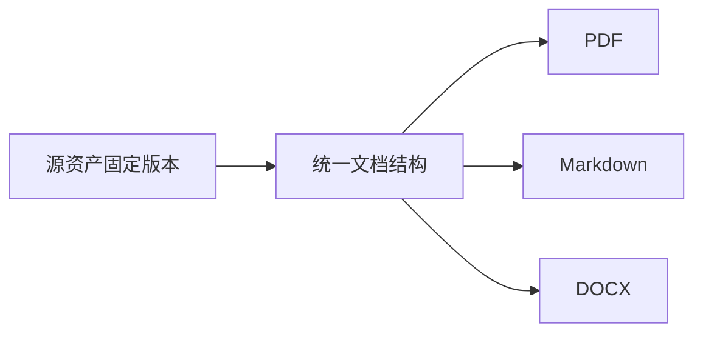

# 合成研究报告：导出回归

本文件仅用于验证导出结构，**不代表真实研究结论**。SOURCE-BEGIN-1024。中文应保持正常方向，英文 Mixed Chinese and English 应能被选择和搜索。

## 1. 段落、格式和编号

第一段包含 **加粗**、*强调*、`inline_code` 和一条[示例链接](https://example.org/paper)。链接不得导致导出阶段自动请求网络。

第二段必须是独立段落，而不能因为导出变成第一段的尾部。

3. 从 3 开始的有序步骤。
4. 第二步含子列表：
   - 第一项。
   - 第二项保留层级。
5. SOURCE-ORDERED-END。

> 这是合成摘录，不是模型核验过的证据。页面位置必须来自已知输入，不能自行编造。[^evidence]

## 2. 公式与代码

行内公式 $x_{n+1}=\frac12(x_n+2/x_n)$ 与单独展示的式子应被区别处理：

$$
\operatorname{Attention}(Q,K,V)
=\operatorname{softmax}\left(\frac{QK^\top}{\sqrt{d_k}}\right)V.
$$

```cpp
// 空格、缩进和最后一行必须保留；软换行不得修改源代码。
std::string long_value = "SOURCE-LONG-CODE-abcdefghijklmnopqrstuvwxyz-0123456789-abcdefghijklmnopqrstuvwxyz-0123456789";
if (ready) {
    export_document();
}
// SOURCE-CODE-END
```

## 3. 表格与合并单元格

| 类型 | 目标 | 明确边界 |
| --- | --- | --- |
| PDF | 稳定阅读 | 不是白板原生格式 |
| DOCX | 可继续编辑 | 不承诺与 PDF 页码一致 |
| Markdown | 可迁移内容 | 合并单元格不是 pipe table 原生语义 |

<table>
<caption>合成合并表格</caption>
<thead><tr><th rowspan="2">方法</th><th colspan="2">合成指标</th></tr><tr><th>列 A</th><th>列 B</th></tr></thead>
<tbody><tr><td>示例一</td><td>10</td><td>20</td></tr><tr><td>示例二</td><td>30</td><td>SOURCE-TABLE-END</td></tr></tbody>
</table>

## 4. 相对图片与图形源码

![几何方向探针，不是论文图][direction]

[direction]: ../probe/input.png "顶部 TOP、底部 BOTTOM；三角形向上"

图注：用于检查方向与相对引用式图片收集。资源包迁移时应改写为包内真实相对路径，不暴露原工作区目录。



## 5. 最后一个章节

最后一段必须在正文、Markdown、DOCX 和 PDF 文本检查中都出现：SOURCE-END-8192。这个标记不能只存在于隐藏元数据。

[^evidence]: 来源：本文件内人工构造的测试文本。没有真实作者、DOI 或原论文页码；导出器不得补造这些字段。

$$
\frac{a}{b} + \sqrt{x} + x^2
$$

<table><thead><tr><th colspan="2">合并表头</th></tr></thead><tbody><tr><td>左</td><td>右</td></tr></tbody></table>

```ts
const marker = "CODE_LAST_LINE";
```

TAIL_EXPORT_MARKER
